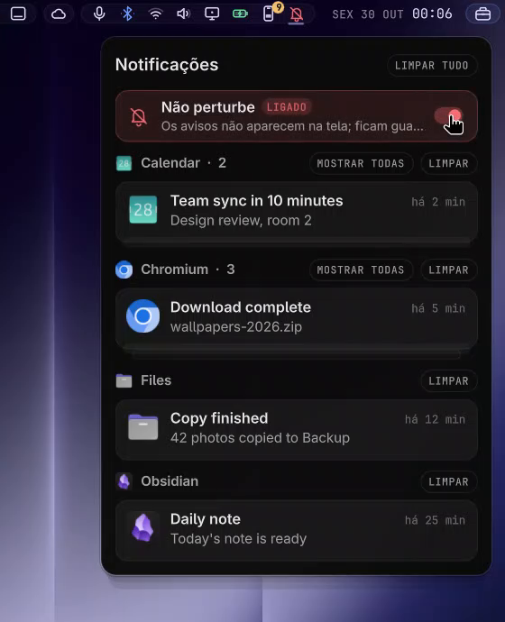

<div align="center">

# Island Inbox

**Your notification history, in a bell on the bar.**
Grouped by app, newest first, with the app's icon, and a click takes you back to where
the notification came from.



</div>

## Why this one

- 🔔 **A bell with a count** of what you haven't seen. With
  [Island Bar](https://github.com/hugorolimf/omarchy-bar) it's drawn in the bar's stroke style.
- 🗂️ **Grouped by app**, the last ones first; open a group to see them all, clear one app or
  everything.
- ↩️ **Click to go back**: to the app, or to the exact terminal and tmux pane for Claude
  Code's notifications when they carry it.
- 📱 iPhone notifications from [Island iPhone](https://github.com/hugorolimf/omarchy-island-iphone)
  show with the app's real icon.
- 🌍 English or Portuguese, following your system language.

## Requirements

- [Island Kit](https://github.com/hugorolimf/omarchy-island-kit): the panel is drawn with it.
- Omarchy's notifications (or [Glass Notifications](https://github.com/hugorolimf/omarchy-notifications)):
  it reads their history in `~/.local/state/omarchy/notifications/history`.
- `inotifywait` (inotify-tools) to follow new notifications live.

## Install

```bash
omarchy plugin add https://github.com/hugorolimf/omarchy-island-kit --enable
omarchy plugin add https://github.com/hugorolimf/omarchy-island-inbox --enable
```

`omarchy-shell io.github.hugorolimf.inbox toggle` opens it.

## Files it writes

`~/.local/state/omarchy/io.github.hugorolimf.inbox/seen.json`: which notifications you've
already seen (for the count).

## Remove

```bash
omarchy plugin remove io.github.hugorolimf.inbox
rm -rf ~/.local/state/omarchy/io.github.hugorolimf.inbox
```

## License

[MIT](LICENSE)
